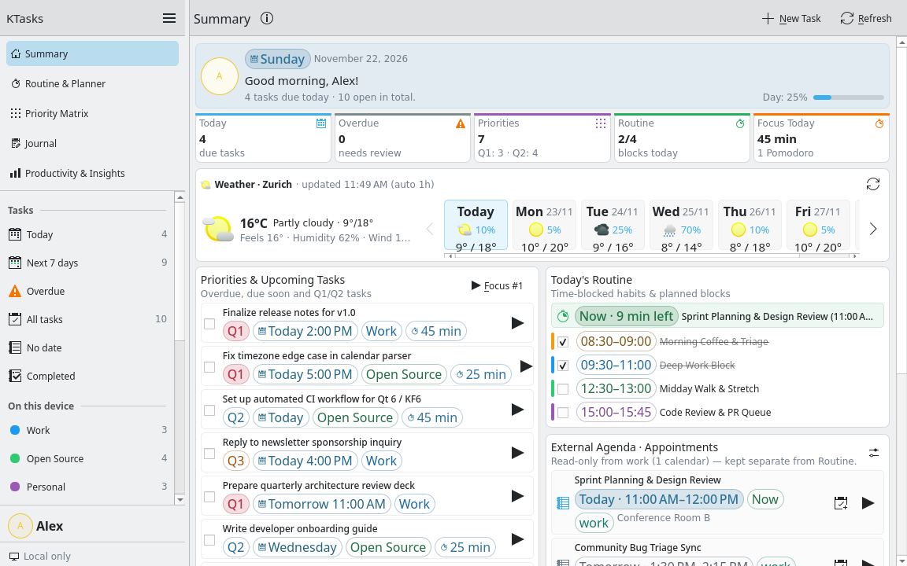
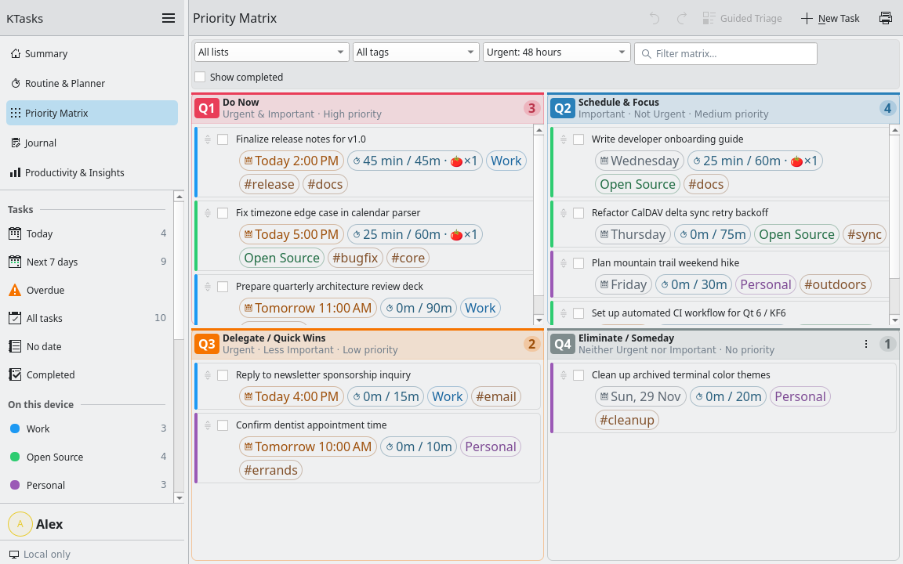

<div align="center">
  
  <h1>KTasks</h1>
  <p>
    <strong>Offline-first Task, Priority Matrix, Pomodoro, Routine &amp; Journal manager for KDE Plasma 6</strong><br />
    Optionally synchronized with Nextcloud (Tasks CalDAV, Calendar &amp; Notes)
  </p>
  <p>
    <a href="LICENSE"></a>
    
    
    
    
  </p>
</div>

---

**KTasks** (`ktasks`, App ID `io.github.marleys439.ktasks`) is an independent, community-developed productivity application built with **C++20, Qt 6, KDE Frameworks 6, Kirigami, and SQLite**. Designed natively for **KDE Plasma 6** (Wayland and X11), it stores all your data locally first and optionally synchronizes tasks, daily routines, and journal notebooks with **Nextcloud** or standard **CalDAV** servers.

> **Community Status:** KTasks is an independent project by a KDE community developer (not yet an official KDE Gear / KDE Incubator project). Pull requests require review and approval by the maintainer (**@MarleyS439**). UI translations include **English** and **Brazilian Portuguese (`pt_BR`)**.

## Screenshots

<p align="center">
  
  
</p>

## Features

### Home Summary Dashboard
- Personalized greeting, weekday/date header, active productive streak, Nextcloud sync status pill, and combined daily progress bar.
- Clickable KPI tiles (*Today*, *Overdue*, *Priorities*, *Routine*, *Focus Today*) and an unobtrusive hover guide on the top panel `i` icon.
- Compact **Open-Meteo Weather & 10-Day Scrollable Forecast** with hourly background refresh and configurable city in **Settings** (reusing KDE KWeather city or IP fallback automatically when unset).
- **Quick Notes & Journal** snapshot with one-click *Today's Note* entry (locked entries never expose content).
- **External Agenda (Read-Only)**: Optionally reads appointments from **KOrganizer / Akonadi** (Google Calendar, Birthdays, personal DAV/local `.ics` calendars when Akonadi is running) or extra `.ics` files — kept strictly separate from Nextcloud Routine sync, flagging schedule overlaps and offering 1-click *Create prep task* or *Start Pomodoro*.

### Tasks & Smart Lists
- Nested subtasks, color-coded lists, tags, priorities, start/due dates, completion progress, Markdown notes, `RRULE` recurrence, and `VALARM` reminders.
- Smart views: *Today*, *Next 7 Days*, *Overdue*, *All Tasks*, *No Date*, and *Completed*.
- Accent-insensitive instant search, drag-and-drop list ordering/reparenting, Dolphin-style `Ctrl`/`Shift` multi-selection, atomic **Undo/Redo**, batch copy/email, `.ics` import/export, and PDF printing/export.
- **Natural-language quick entry** (`en` / `pt`): e.g. `Pay rent tomorrow 9am !high #home`, `Academia toda segunda 7h`.
- **Plasma integration**: interactive desktop notifications (*Complete* / *Snooze* / *Tomorrow*), system tray icon, task manager badge counter, global shortcut (`Meta+Alt+N`), configurable KCommandBar/shortcuts, and session autostart.

### Eisenhower Priority Matrix & Focus Timer
- Four visual quadrants (**Q1 Do Now**, **Q2 Schedule**, **Q3 Delegate**, **Q4 Eliminate**) plus **Guided Triage** mode.
- Drag-and-drop sorting between/within quadrants, automatic deadline urgency promotion, and undoable bulk Q4 cleanup.
- Built-in **Pomodoro timer & execution stopwatch** with persistent top bar, break cycles, per-task tracked execution time, and Plasma completion notifications.

### Productivity & Insights
- 1-day, 7-day, and 30-day activity/focus bar charts, quadrant time distribution, estimation accuracy, routine adherence, and automated insights.

### Routine & Day Planner + Encrypted Journal
- Time-blocked daily planner (*Day / Week / Month* grid views) with recurring templates and optional two-way **Nextcloud CalDAV (`VEVENT`)** synchronization.
- Markdown **Journal & Notebooks** with optional per-entry **AES-256-GCM password locking** and **Nextcloud Notes REST API** synchronization.

## Offline-First Architecture & Compatibility

- **Local Storage:** SQLite database in WAL mode (`~/.local/share/ktasks/ktasks.db`) with automatic pre-migration and scheduled snapshots in `~/.local/share/ktasks/backups/`.
- **Nextcloud / Mobile Compatibility:**
  - *Tasks:* CalDAV `VTODO` (`sync-collection` incremental sync + conditional `If-Match` writes + field-level conflict merging) — compatible with Nextcloud Tasks and Android apps such as **Tasks.org** / **DAVx⁵**.
  - *Routines:* CalDAV `VEVENT` in a dedicated calendar chosen per account.
  - *Journal:* Nextcloud Notes REST API (`index.php/apps/notes/api/v1`) — compatible with the **Nextcloud Notes** web and mobile apps.
  - Credentials are stored securely in the desktop keyring via **QtKeychain** (`KWallet` / `Secret Service`), and authentication supports **Nextcloud Login Flow v2**.
- **KDE & Desktop Compatibility:**
  - Requires **Qt >= 6.6**, **KDE Frameworks >= 6.5**, and **Kirigami Addons >= 1.4**.
  - Works on **Wayland** and **X11**. Built natively for **KDE Plasma 6** (`org.kde.desktop` style and `Breeze` icons), and portable to other Linux desktops via Flatpak (`packaging/io.github.marleys439.ktasks.yml`) using `org.kde.Platform//6.8`.
  - **`KPim6::AkonadiCore` (KOrganizer integration) is optional** at build time (`find_package(KPim6Akonadi QUIET)`) and passive at runtime (never starts Akonadi unless the daemon is already active in your session).

## Dependencies

Minimum toolchain and library versions from [`CMakeLists.txt`](CMakeLists.txt):
- CMake `>= 3.22`, C++20 compiler, Extra CMake Modules (`ECM >= 6.5.0`)
- Qt 6 `>= 6.6.0` (`Core`, `Gui`, `Widgets`, `Qml`, `Quick`, `QuickControls2`, `Sql`, `Network`, `DBus`, `PrintSupport`, `Test`)
- KDE Frameworks 6 `>= 6.5.0` (`CoreAddons`, `Config`, `I18n`, `CalendarCore`, `Notifications`, `DBusAddons`, `StatusNotifierItem`, `ColorScheme`, `GlobalAccel`, `WindowSystem`, `Crash`, `IconThemes`)
- `KF6Kirigami >= 6.5.0`, `KF6KirigamiAddons >= 1.4`
- `Qt6Keychain`, `OpenSSL`, `breeze-icons`, `qqc2-desktop-style`
- *Optional:* `KPim6Akonadi` (`Core`) for reading KOrganizer/Google/desktop calendars on the Summary screen.

<details>
<summary>Package install commands by distribution</summary>

#### Arch Linux / CachyOS / EndeavourOS
```bash
sudo pacman -S --needed cmake extra-cmake-modules ninja base-devel \
  qt6-base qt6-declarative kirigami kirigami-addons qqc2-desktop-style \
  kcoreaddons kconfig ki18n kcalendarcore knotifications kdbusaddons \
  kstatusnotifieritem kcolorscheme kglobalaccel kwindowsystem kcrash \
  kiconthemes qtkeychain-qt6 breeze-icons openssl
# Optional (for KOrganizer/Google calendar integration on Summary):
sudo pacman -S --needed akonadi
```

#### Fedora (40+)
```bash
sudo dnf install cmake extra-cmake-modules ninja-build gcc-c++ openssl-devel \
  qt6-qtbase-devel qt6-qtdeclarative-devel kf6-kirigami-devel kf6-kirigami-addons-devel \
  kf6-kcoreaddons-devel kf6-kconfig-devel kf6-ki18n-devel kf6-kcalendarcore-devel \
  kf6-knotifications-devel kf6-kdbusaddons-devel kf6-kstatusnotifieritem-devel \
  kf6-kcolorscheme-devel kf6-kglobalaccel-devel kf6-kwindowsystem-devel \
  kf6-kcrash-devel kf6-kiconthemes-devel qtkeychain-qt6-devel kf6-qqc2-desktop-style breeze-icon-theme
```

#### openSUSE Tumbleweed
```bash
sudo zypper install cmake extra-cmake-modules ninja gcc-c++ libopenssl-devel \
  qt6-base-devel qt6-declarative-devel kf6-kirigami-devel kirigami-addons6-devel \
  kf6-kcoreaddons-devel kf6-kconfig-devel kf6-ki18n-devel kf6-kcalendarcore-devel \
  kf6-knotifications-devel kf6-kdbusaddons-devel kf6-kstatusnotifieritem-devel \
  kf6-kcolorscheme-devel kf6-kglobalaccel-devel kf6-kwindowsystem-devel \
  kf6-kcrash-devel kf6-kiconthemes-devel qtkeychain-qt6-devel kf6-qqc2-desktop-style breeze6-icons
```

</details>

## Building & Installing

```bash
cmake -S . -B build -DCMAKE_BUILD_TYPE=Release -DCMAKE_INSTALL_PREFIX="$HOME/.local"
cmake --build build -j"$(nproc)"
cmake --install build --strip
```

Or build an Arch Linux package using [`packaging/PKGBUILD`](packaging/PKGBUILD):
```bash
cd packaging && makepkg -si
```

## Running Tests & Validation

```bash
QT_QPA_PLATFORM=offscreen ctest --test-dir build --output-on-failure
appstreamcli validate --pedantic --no-net data/io.github.marleys439.ktasks.metainfo.xml
desktop-file-validate data/io.github.marleys439.ktasks.desktop
```

## Command-Line Usage & Diagnostics

```bash
ktasks --add "Buy milk tomorrow 9am #home"   # Add task to running instance (or start briefly)
ktasks --quick-add                           # Open global quick entry dialog
ktasks --hidden                              # Start minimized in the system tray
QT_LOGGING_RULES="ktasks.*=true" ktasks      # Enable debug logs (passwords/content redacted)
```

## Translations

Source strings use KDE `ki18n`/`i18nc` macros. Update and validate translation catalogs with:

```bash
find src \( -name "*.cpp" -o -name "*.h" -o -name "*.qml" \) | sort > /tmp/po_files.txt
xgettext --from-code=UTF-8 --c++ --kde -ci18n -ki18n:1 -ki18nc:1c,2 -ki18np:1,2 -ki18ncp:1c,2,3 \
  -kki18n:1 -kki18nc:1c,2 -kki18np:1,2 -kki18ncp:1c,2,3 -f /tmp/po_files.txt -o po/ktasks.pot
msgmerge --update --backup=none po/pt_BR/ktasks.po po/ktasks.pot
msgfmt --check --statistics -o /dev/null po/pt_BR/ktasks.po
```

## Contributing

See [`CONTRIBUTING.md`](CONTRIBUTING.md) and [`SECURITY.md`](SECURITY.md). All pull requests are reviewed and must be approved by **@MarleyS439** via [GitHub Issues & Pull Requests](https://github.com/MarleyS439/ktasks).

## License

This project is licensed under the **GNU General Public License v3.0 or later** ([`GPL-3.0-or-later`](LICENSES/GPL-3.0-or-later.txt)).
AppStream metadata is licensed under [`CC0-1.0`](LICENSES/CC0-1.0.txt).
